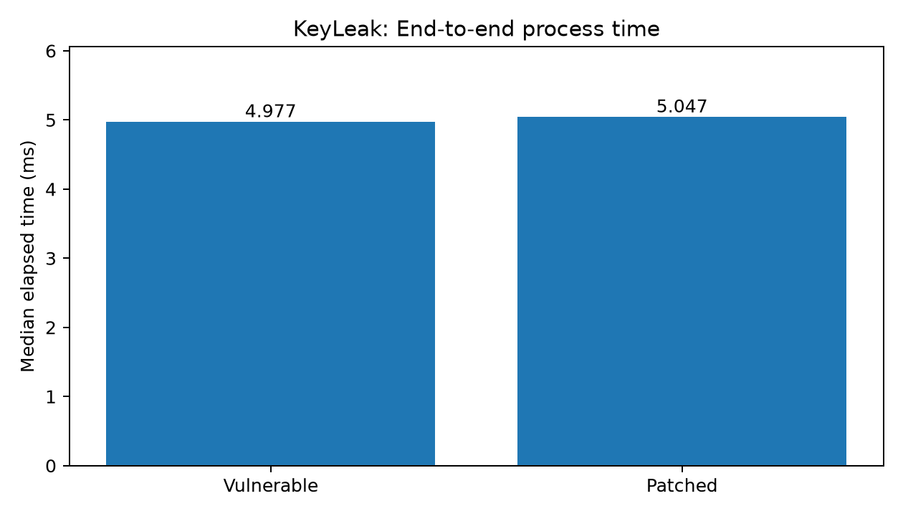
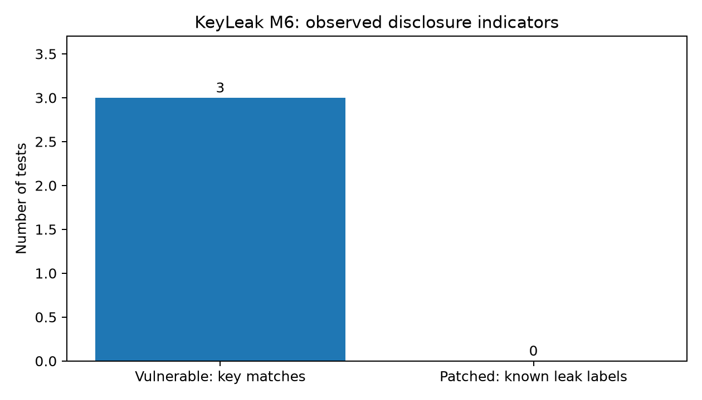

# KeyLeak: AES-256 Key Recovery Through Memory Disclosure and Security Mitigation

## Overview

**KeyLeak** is an academic cybersecurity project that demonstrates how memory-safety vulnerabilities can compromise the confidentiality of encrypted information, even when strong cryptographic algorithms such as AES-256-GCM are used.

The project implements a deliberately vulnerable C application that generates an AES-256 encryption key, stores a copy of the key adjacent to an input buffer, and exposes sensitive memory through an out-of-bounds read.

A Python-based demonstration extracts the disclosed key and uses it to decrypt the original ciphertext, proving the confidentiality impact of key exposure.

A patched version of the application implements bounds-checked input handling, compiler-assisted stack canaries, and secure memory zeroization. The effectiveness and performance of these changes are evaluated through automated testing.

**Project scope:** Local, controlled security experimentation using self-developed applications. No remote exploitation, shellcode execution, or return-oriented programming is implemented.

---

## Project Objectives

1. Implement AES-256-GCM encryption and decryption using OpenSSL.
2. Analyze the memory layout of a C application using GDB.
3. Demonstrate an out-of-bounds memory disclosure involving an AES key.
4. Reconstruct the disclosed encryption key.
5. Decrypt ciphertext using the recovered key.
6. Implement bounds checking, stack canaries, and secure zeroization.
7. Compare vulnerable and patched applications through automated security testing.
8. Evaluate performance overhead and memory-cleansing behavior.

## Technologies Used

| Technology | Purpose |
|---|---|
| C | Vulnerable and patched applications |
| Python 3 | Key extraction, decryption, and testing |
| OpenSSL | AES-256-GCM and secure random generation |
| GCC | Compilation and stack-protector instrumentation |
| GDB | Stack and memory-layout analysis |
| Cryptography library | Python AES-GCM decryption |
| Matplotlib | Performance and security visualization |
| Git and GitHub | Version control |
| Ubuntu Linux | Development and testing environment |

## System Architecture

```text
                 KEYLEAK SYSTEM
                       |
                       v
             Vulnerable C Application
                       |
                       v
              RAND_bytes() CSPRNG
                       |
                       v
               AES-256-GCM Key
                       |
                       v
            Encrypt Confidential Data
                       |
             +---------+---------+
             |                   |
             v                   v
       Ciphertext + Tag    Key in Stack Memory
             |                   |
             |                   v
             |           Out-of-Bounds Read
             |                   |
             |                   v
             |            Key Disclosure
             |                   |
             |                   v
             |            Key Reconstruction
             |                   |
             +---------+---------+
                       |
                       v
              AES-GCM Decryption
                       |
                       v
             Original Plaintext
                       |
                       v
           Confidentiality Compromised


               SECURITY MITIGATION
                       |
                       v
              Patched Application
                       |
           +-----------+-----------+
           |           |           |
           v           v           v
        Bounds       Stack       Secure
        Checking     Canaries    Zeroization
           |           |           |
           +-----------+-----------+
                       |
                       v
              Security Verification
                       |
                       v
              Performance Evaluation
```

## Project Modules

### M1 — Vulnerable Target Application

**Location:** `vulnerable/server.c`

Implements AES-256-GCM encryption and decryption using OpenSSL.

Key features:

- Generates a random 256-bit AES key using `RAND_bytes()`.
- Generates a 12-byte initialization vector.
- Encrypts a confidential message using AES-256-GCM.
- Generates a 16-byte authentication tag.
- Performs authenticated decryption.
- Verifies that the decrypted plaintext matches the original message.

**Expected verification:**

```text
[M1] Decrypted plaintext: Confidential KeyLeak message
[M1] AES-256-GCM test: PASS
```

### M2 — Stack Reconnaissance

**Location:** `vulnerable/server.c` and `recon/`

Analyzes the relationship between the input buffer and adjacent key material.

The demonstration uses the following structure:

```c
struct vulnerable_frame
{
    char input[64];
    unsigned char exposed_key[32];
};
```

Memory arrangement:

```text
+----------------------------+
| input[64]                  |
| 64 bytes                   |
+----------------------------+
| exposed_key[32]            |
| 32-byte AES key copy       |
+----------------------------+
| Total: 96 bytes            |
+----------------------------+
```

GDB is used to inspect memory addresses, structure layout, and relevant stack information.

### M3 — Information Disclosure

**Location:** `exploit/leak.py`

Demonstrates an out-of-bounds read in the vulnerable application.

Although the input buffer contains only 64 bytes, the application prints 96 bytes beginning at the input buffer.

The final 32 bytes contain a copy of the AES key.

The Python script:

1. Executes the vulnerable application.
2. Captures the disclosed hexadecimal memory region.
3. Extracts bytes 64–95.
4. Reconstructs the 32-byte AES key.
5. Verifies the key against the original value in the controlled test.
6. Saves the recovered key and encryption parameters for M4.

**Recorded result:** Key extraction and verification successful.

**Vulnerability classification:** CWE-125 — Out-of-bounds Read.

### M4 — Key Reconstruction and Decryption

**Location:** `m4/decrypt.py`

Uses the AES key recovered in M3 to decrypt the original ciphertext.

Required parameters:

| Parameter | Size |
|---|---|
| AES-256 key | 32 bytes |
| GCM IV | 12 bytes |
| Authentication tag | 16 bytes |
| Ciphertext | Depends on plaintext length |

The key, IV, ciphertext, and authentication tag are captured from the same vulnerable-server execution to ensure consistency.

**Recorded result:**

```text
[M4] AES-256-GCM decryption: SUCCESS
[M4] Recovered plaintext: Confidential KeyLeak message
[M4] Plaintext verification: PASS
```

This demonstrates that exposure of the encryption key compromises confidentiality without breaking the AES algorithm itself.

### M5 — Patched Target Application

**Location:** `patched/server_patched.c`

Implements three security mechanisms.

**1. Bounds checking**

Validates input length and rejects inputs exceeding the permitted 64-byte capacity.

The patched application also removes the excessive memory read and the unnecessary adjacent copy of the encryption key.

**2. Stack canaries**

Uses GCC's `-fstack-protector-all` option to add stack-integrity checks against certain stack-buffer overwrites.

**3. Secure zeroization**

Uses `OPENSSL_cleanse()` to overwrite designated sensitive buffers after use.

The patched application retains AES-256-GCM encryption and decryption functionality.

**Recorded observations:**

```text
[M5] AES-GCM self-test: PASS
[M5] Input rejected: exceeds 64 bytes.
[M5] Sensitive buffers cleansed
```

Stack canaries are a supplementary defense. They are not the mechanism responsible for preventing the demonstrated out-of-bounds read.

### M6 — Re-exploitation and Security Verification

**Location:** `m6/verify.py`

Automates security testing of both vulnerable and patched applications using identical input payloads.

| Test | Payload length | Vulnerable key recovery | Patched behavior | Result |
|---|---:|---|---|---|
| T1 | 64 bytes | Successful | Accepted; no known disclosure | PASS |
| T2 | 65 bytes | Successful | Rejected | PASS |
| T3 | 128 bytes | Successful | Rejected | PASS |

**Recorded results:**

```text
Total tests: 3
Passed: 3
Failed: 0

[M6] SECURITY VERIFICATION: PASS
```

Test success rate:

\[
\text{Success Rate}=\frac{3}{3}\times100=100\%
\]

The patched disclosure check verifies the absence of known key-disclosure output labels. It does not prove the absence of all possible information leaks.

### M7 — Performance Evaluation and Final Validation

**Location:** `m7/`

Includes three components.

**Performance benchmarking — `benchmark.py`**

Measures process-level execution times across 100 runs of each application.

| Metric | Vulnerable | Patched |
|---|---:|---:|
| Mean execution time | 5.9469 ms | 5.7093 ms |
| Median execution time | 4.9771 ms | 5.0472 ms |
| Standard deviation | 2.0916 ms | 1.5454 ms |
| Executions | 100 | 100 |

Median performance overhead:

\[
\text{Overhead}(\%)=
\frac{5.0472-4.9771}{4.9771}\times100
=\boxed{1.41\%}
\]

The measurement includes process startup, cryptographic operations, and I/O. It represents the observed difference between the complete applications, not the isolated cost of stack-canary instrumentation.

**Secure zeroization — `zeroization_test.c`**

Tests memory cleansing of a designated 32-byte key buffer.

Before cleansing:

```text
5f14896b2bf169c4610d613abab7e40caddc2096a2fd1cfe7324479cfcd5b469
```

After cleansing:

```text
0000000000000000000000000000000000000000000000000000000000000000
```

**Result:** Zeroization verification PASS.

This verifies the designated buffer but does not establish complete process-wide zeroization.

**Security evaluation — `evaluate.py`**

Analyzes the M6 test results and generates the final security comparison.

Recorded summary:

```text
tests: 3
passed: 3
pass_rate_percent: 100.0
vulnerable_key_match_tests: 3
patched_known_disclosure_label_tests: 0
patched_aes_pass_tests: 3
```

---

## Installation and Setup

### Prerequisites

Ubuntu Linux with GCC, GDB, OpenSSL development libraries, Python 3, and Python virtual-environment support.

Install system dependencies:

```bash
sudo apt update
sudo apt install -y \
    build-essential \
    gdb \
    libssl-dev \
    python3 \
    python3-venv \
    python3-pip \
    binutils
```

### Clone the repository

```bash
git clone https://github.com/neha-das17/keyleak.git
cd keyleak
```

### Create and activate the Python environment

```bash
python3 -m venv .venv
source .venv/bin/activate
```

Install Python dependencies:

```bash
python -m pip install cryptography matplotlib
```

## Compilation

Compile the vulnerable application:

```bash
gcc -O0 -g vulnerable/server.c \
    -o vulnerable/server -lcrypto
```

Compile the patched application:

```bash
gcc -O0 -g -Wall -Wextra \
    -fstack-protector-all \
    -fPIE -pie \
    patched/server_patched.c \
    -o patched/server_patched \
    -lcrypto
```

Compile the zeroization test:

```bash
gcc -O0 -g -Wall -Wextra \
    m7/zeroization_test.c \
    -o m7/zeroization_test \
    -lcrypto
```

## Execution Guide

Run all commands from the repository root.

### M1 — AES-256-GCM functionality

```bash
printf 'HELLO\n' | ./vulnerable/server
```

### M2 — Memory-layout inspection

```bash
gdb ./vulnerable/server
```

Inside GDB:

```gdb
break main
run
print sizeof(struct vulnerable_frame)
print (long)&((struct vulnerable_frame *)0)->exposed_key
quit
```

### M3 — Key disclosure

```bash
python exploit/leak.py
```

### M4 — Key reconstruction and decryption

```bash
python m4/decrypt.py
```

Run M3 before M4 so that the corresponding session data exists.

### M5 — Patched application

Normal input:

```bash
printf 'HELLO\n' | ./patched/server_patched
```

Oversized input:

```bash
python -c 'print("A"*128)' | ./patched/server_patched
```

Verify stack-protector instrumentation:

```bash
readelf -Ws patched/server_patched | grep __stack_chk_fail
```

### M6 — Automated security verification

```bash
python m6/verify.py
```

### M7 — Performance benchmark

```bash
python m7/benchmark.py --runs 100
```

### M7 — Secure zeroization verification

```bash
./m7/zeroization_test
```

### M7 — Security evaluation

```bash
python m7/evaluate.py
```

## Experimental Results and Graphs

The M7 scripts generate result files inside `m7/results/`.

**Execution-time comparison:**



**Security comparison:**



The figures summarize measured process-level execution times and the observed security test outcomes.

## Research Foundation

The project draws on three research works:

**1. Aleph One — *Smashing the Stack for Fun and Profit* (1996)**

Provides foundational concepts for understanding stack layout, unsafe memory operations, and exploitation techniques.

Applied concept: Memory-layout analysis and vulnerability investigation in M2/M3.

**2. Cowan et al. — *StackGuard: Automatic Adaptive Detection and Prevention of Buffer-Overflow Attacks* (1998)**

Introduces stack-canary-based detection of certain stack-buffer overwrites.

Applied concept: Compiler-assisted stack protection in M5.

**3. Arranz Olmos et al. — *High-Assurance Zeroization***

Examines the challenges of reliably eliminating sensitive data from memory, including dead-store elimination and temporary key copies.

Applied concept: Secure memory cleansing and its limitations in M5/M7.

## Security Considerations and Limitations

- The application is deliberately vulnerable and intended only for controlled academic experimentation.
- The demonstrated vulnerability is an out-of-bounds read, not a return-address overwrite.
- The vulnerable application includes a debug-only original-key output used for verification.
- The patched application removes that output and the demonstrated excessive memory read.
- Stack-canary instrumentation is enabled, but a canary-triggering exploit was not demonstrated.
- The zeroization test confirms cleansing of a designated buffer, not every copy of the key in memory or registers.
- M6 verifies the absence of known disclosure output patterns, not the absence of all vulnerabilities.
- Performance measurements include complete process execution and are subject to operating-system scheduling and measurement variability.
- Recovered keys and generated session files must not be committed to a public repository.

## Conclusion

KeyLeak demonstrates that strong cryptographic algorithms cannot guarantee confidentiality when their encryption keys are exposed through memory-safety vulnerabilities.

The project successfully recovered a 256-bit AES key from a deliberately vulnerable application and used it to decrypt the original ciphertext.

The patched application prevented the demonstrated key-disclosure behavior while preserving legitimate AES-GCM functionality.

All three defined security verification tests passed. The recorded median process-level performance overhead was approximately **1.41%**, and the designated key-buffer zeroization test passed.

The project highlights the importance of combining cryptographic security with safe memory access, defensive compilation, and careful handling of sensitive key material.

---

**Disclaimer:** This repository is intended for educational security research and controlled local testing only.
